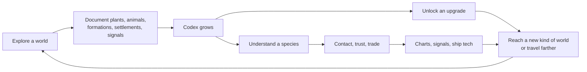

# Progression: knowledge and contact

Status: **Phase 1 built**: the codex, the upgrade tree and the upgrade screen (U) are in the game. Every Kestrel-chapter upgrade works, plus most side upgrades that open in it; the rest of the effects are to-do, and the roadmap ticks off what has landed. **The line is not final**: upgrades will be added, moved and given new tasks. Each effect only asks whether its upgrade is installed (`codex.unlocked.has(id)`, via the readers in `upgrades.mjs`), never where it sits in the line, so rearranging is a data change.

## Identity

**Elsewhere is about being a naturalist in an alien galaxy.** You go places, look closely, and come to understand what lives there. **Knowledge** and **relationships** are the only currencies:

- What you **document** (plants, animals, formations, settlements, signals) becomes the knowledge your ship is built from. Each upgrade opens a new kind of place.
- What you **learn about minds** lets you reach intelligent species, earn their trust and trade knowledge with them.

**What it is not:** no combat, no mining, no inventory, no crafting, no base building. They would turn the ecosystem into targets and resources, pull the game toward a survival grind, and cost a lot on phones.

**Danger is not combat.** Big hunters stalk you on foot, the suit can fail, star heat burns and night falls. Tension comes from the world, and the answer is always to move, retreat to the ship or come back better equipped. There is never a weapon.

## Design rules

1. **Everything is open from the start.** Every rocky world you can land on today stays landable. Upgrades only open places nobody can reach yet: underwater, under ice, inside giants, farther stars. Gating takes away freedom and reads as a punishment.
2. **An upgrade opens a door.** "+10% scan range" is filler; most nodes should let you go somewhere or do something you could not before.
3. **The first unlock comes within ten minutes.** Starter nodes can be finished on the first world you land on.
4. **Every landing pays.** Even a lifeless moon has formations to record, so no world is empty.
5. **Variety, not volume.** Ask for "3 different body plans", not "30 animals". Counts stay small (1–5).
6. **Requirements are questions about traits, never named species.** See below.
7. **Names, never numbers**, in saves and requirements (see Data model).

## The core loop



## The key rule: requirements match traits, not named species

Every species is generated, so a requirement can never say "scan the Glowing Reef Eel". Requirements are **questions about traits the generator already produces**, such as:

- "Observe 3 animals from worlds with liquid seas"
- "Catalogue a glowing plant"
- "Observe a carnivore and the herbivore it hunts"
- "Record 2 kinds of volcanic formation"
- "Record a settlement of village builders or higher"

This gives two benefits:

1. **Hints come for free.** A requirement for "a drifter" can say *Found on: thick-air or low-gravity worlds with complex life*, because that is what `PLANS.floater.fit` favours. The hint text is generated from the requirement, not written by hand.
2. **New generator traits automatically become new requirements.** Anything added to `flora.mjs`, `fauna.mjs`, `geology.mjs` or `civilizations.mjs` can be used in the tree.

### Traits available today

| Source | Field | Values |
|---|---|---|
| World (`biomes.mjs` `classify`) | biome | Volcanic, Toxic, Desert, Verdant, Oceanic, Frozen, Amethyst, Barren |
| World (`body.physics`) | life | none, microbial, simple, complex |
| World | biochemistry | water, ammonia, methane, sulfur, silicon |
| World | waterState, subsurfaceOcean, tidallyLocked | liquid / ice / …, true/false |
| World | gravity, pressure, temperature, volcanism | numbers |
| Giant (`GIANT_CLOUDS`) | cloud type, rings | ammonia, methane, water, clear, alkali, silicate; ringed or not |
| Star (`physics.mjs`) | spectral class | O … M (half are red dwarfs) |
| Plant (`flora.mjs` `FORMS`) | form | tree, conifer, palm, shrub, grass, succulent, fungus, stalk, mat, mound; exotic: crystal, glasstree, chimney, plume, bulb, sheet, filament, crust |
| Plant | glow, habitat | 0–1; temperature / moisture / shore / highland preference |
| Formation (`geology.mjs`) | kind | basalt columns, obsidian shards, fumaroles, hoodoos, rock arches, penitentes, pingos, cryovolcanoes, crystal spires, mineral terraces, sulfur chimneys, karst pinnacles, sea stacks, impact boulders, banded outcrops; rare: geodes, iron meteorites |
| Animal (`fauna.mjs` `PLANS`) | body plan | quadruped, hexapod, biped, serpent, flyer, floater, arachnid, slug, radial, roller, swimmer (sea life) |
| Animal | form | runner, tank, raptor, mantis, spider, eel, bat, bell, manta, tripod, wheel, centipede, tower, dome, skywhale, siphon; swimmers: fish, hunter, leviathan, squid, jelly, ray, ribbon, disc |
| Animal | build, alien | ordinary, giant, heavy, lanky; hammerhead, stalkeye, headless, proboscis |
| Animal | diet | herbivore, omnivore, carnivore, filter |
| Animal (`ecology.mjs`) | activity, stalksYou | diurnal, nocturnal, crepuscular, any; dangerous to explorers or not |
| Animal | mind, manipulators | instinctive, simple, cunning, clever; tool users … system-shapers; hands, tentacles, mandibles, … |
| Civilization (`civilizations.mjs`) | tier, reach, family, culture | tool users … system-shapers; local, world, orbit, system; hands, hive, drifters, …; timber, hive, tethered, silk, … |
| Settlement (`traces`) | tier | the tier you recorded (a name) |
| Radio signal (`signals.mjs`) | tier | planet-shapers, spacefarers, system-shapers |

### Things to scan

| Category | Today | Later |
|---|---|---|
| **Flora** | ✅ scanned (aim, hold E) within a few metres (`catalogue`) | partial scans, rare variants |
| **Fauna** | ✅ scanned from a distance (`bestiary`) | |
| **Behaviour** | ✅ watched (`behaviour` in the codex): grazing, drinking, asleep, hunting, feeding on a catch, standing its ground; hold E on a scanned animal while it does it | courtship, migration, nesting |
| **Sky events** | ✅ recorded on foot (`phenomenon`): eclipses, aurorae, meteor showers, with a forecast in the HUD (`phenomena.mjs`) | flares, comets, ring shadows, planetary alignments |
| **Geology** | ✅ scanned (`geology`): 2–3 natural rock types on every world with a surface, plus a landform (columns, hoodoos, sea stacks…) on about 2 worlds in 5; spread over the whole world, with a few near the landing site | rare variants, samples from deep formations |

**How a scan feels** (`scanning.js`, `scan-ui.js`): aim the crosshair at a plant, an animal or a rock within reach. A ring appears around the crosshair, with "Unknown animal" (or its name, if already recorded) below. Hold E until the ring fills (about 1.3 s); look away or let go and it drains. Then the ring pulses and a card slides in: the name, a one-line description, labelled facts (diet, body, when it is active, temper, mind, what it hunts and what hunts it, chemistry; for plants form, height and where they grow; for rocks what kind of rock), tags such as *Dangerous* or *Glows*, and what the scan counted toward. Pressing E on something already recorded shows its card again. Upgrades are installed the same way: hold the button until its bar fills. Settlements still record themselves when you come near, and they get the same card.
| **Settlements** | ✅ recorded within ~45 m (`traces`) | scanning individual building cultures |
| **Signals / field notes** | ✅ investigated on foot (`records`) | the Senders' trail (see Mystery) |
| **Radio sources** | ✅ heard on the star map (`signals.mjs`): the Kestrel hears planet-shapers out to 24 ly and spacefarers out to 45; the Long-range receiver 80 and 150. Until the Signal decoder they are unidentified | what they say, through Contact |
| **Worlds from orbit** | ✅ long-range biosignature scan on the map; with Orbital survey, every system in jump range shows its worlds as if visited | recording a world from orbit into the codex |
| **Giant atmospheres** | ❌ | cloud samples with an atmospheric probe |
| **Space structures** | ✅ stations and arks: dock on the landing deck of an orbital, spacefaring or system-shaping civilization (each its own plan and size), or a spaceborne civilization's ark, and walk it; the first visit records a `station` entry | megastructures, derelicts (see Future-proofing) |

## First steps: the first ten minutes

**Decided: the field scanner is part of the Kestrel from the start.** Scanning is the core verb, so its feedback is never locked: on foot, aim at anything and the crosshair prompt says whether it is recorded, and the HUD counts what is left on the world. First steps is the tutorial instead. Before your first scan, the HUD panel (where the expedition objective used to be) says how to scan. Then it shows the research in progress. Suit plating can be finished on the first world you land on, and Orbital survey sends you to a second world.

## The upgrade line

**Decided:** upgrades are one main line plus optional side upgrades, not a set of parallel branches. Research is always deliberate, so nothing unlocks by accident, and the next step is always clear. Built in `upgrades.mjs`, `objectives.mjs` and `upgrades-ui.js`.

- **One main line**, step by step, in three chapters named after the ship you fly (Kestrel, Petrel, Albatross). A new ship ends each chapter. The next main step is always being researched.
- **Side upgrades** hang off the line, each opening at a main step. They are optional gear. You can research **one side upgrade at a time** alongside the main line.
- **Only research can be installed.** Scans made earlier still count, so a step you have already done ticks off as soon as it becomes your research.
- **Every upgrade has a gear:** ship (where you can go), suit (what you can do on foot), scanner, vehicle or knowledge. The line alternates ship and suit steps.
- **Tasks you can act on.** Each task is a sentence ("Scan a plant on a Desert world"). For each task the game finds the **nearest place** that would move it forward (`objectives.mjs`): the world you are on, the rest of the system, then systems one and two jumps away. **Show on map** opens the star map there. Systems you have not visited are named by their star, because the map does not show their worlds yet.
- **The screen** (U) is a picture of the line: chapters, the main line down the middle, side upgrades to the left, and icons for each kind of gear. Circles show the state: filled for installed, gold for researching, pulsing when ready, violet for side upgrades you can research, and dashed for locked. Tap one for its card: what it does, its tasks with places, and *Hold to install* once research is done.
- **The HUD panel** (top right) shows the main research, its tasks, the nearest place for the next task, and a one-line summary of the side research.

### Chapter: Kestrel

Your first ship. Learn to scan, then reach farther.

| Step | Upgrade | Gear | Effect | Tasks | Effect status |
|---|---|---|---|---|---|
| 1 | **Suit plating** | Suit | Your suit takes 30% less damage and recovers twice as fast. | Scan 3 things on one world | Works |
| 2 | **Orbital survey** | Ship | The star map shows the worlds of every system in jump range: biome, chemistry and life, before you go. | Scan 5 things, on 2 different worlds | Works |
| 3 | **Jump drive II** | Ship | Jump range 12 → 16 light years. | Scan 3 plants · Scan things on 3 kinds of world | Works |
| 4 | **Thermal lining** | Suit | On worlds colder than −80 °C or hotter than 80 °C, the suit's heat reserve lasts four times longer. | Scan something on a world colder than −80 °C · Scan something on a world hotter than 80 °C | Works |
| 5 | **Heat plating** | Ship | The hull heats up more slowly near stars, and you can land right beside lava (without it, the Kestrel keeps ~25 m clear, except on the world's own landing pad). | Scan volcanic rock or a volcanic landform · Watch animals do 2 different things | Works |
| 6 | **Petrel** | Ship | A new ship for seas and storms: it can set down and float on water. Opens the Petrel chapter. | Fully document 2 worlds with life: every plant, animal and rock | Partly built (its own model and name; floats on water; handling later) |

### Chapter: Petrel

A sea and storm ship: under water, and the first contact with other minds.

| Step | Upgrade | Gear | Effect | Tasks | Effect status |
|---|---|---|---|---|---|
| 7 | **Pressure hull I** | Ship | The Petrel becomes a submarine: fly low over deep water and hold F (or press F while afloat) to dive, down to 40 m. Hold R at the surface to fly out. | Watch 2 kinds of animal drink at the shore · Scan 2 animals that live in the sea · Scan sea stacks or a shoreline plant | Works |
| 8 | **Xenolinguistics** | Knowledge | Make sense of tool users, village builders and metalworkers: greet them in their towns and trade what you know. | Find a settlement | Works |
| 9 | **Pressure hull II** | Ship | Deep dives to the sea floor anywhere, and the oceans hidden under the ice of frozen moons. | Scan a plant that grows under water · Scan water ice, pingos or a cryovolcano | Partly built (deep dives; under-ice oceans later) |
| 10 | **Jump drive III** | Ship | Jump range 16 → 24 light years. | Scan animals of 4 different body plans · Record 2 kinds of sky event · Record 2 rare finds | Works |
| 11 | **Signal decoder** | Knowledge | Radio sources on the map say who is broadcasting: the species, their tier, their world and what they are sending. | Find a settlement of village builders or higher | Works |
| 12 | **Albatross** | Ship | The deep-range ship. Opens the Albatross chapter. | Scan life built on 3 different chemistries · Befriend a spacefaring civilization | Tasks work; the ship is to build |

### Chapter: Albatross

The deep-range ship: into giants and across the galaxy.

| Step | Upgrade | Gear | Effect | Tasks | Effect status |
|---|---|---|---|---|---|
| 13 | **Cryo seals** | Ship | Dive (and, with the Dive suit, swim) in seas of liquid methane and ammonia. | Scan life on a methane world · Scan life on an ammonia world | Works |
| 14 | **Cloud diver** | Ship | Descend below 250 m into the clouds of gas and ice giants. | Visit 3 giants with different clouds · Scan 2 drifters | To build |
| 15 | **Diplomatic protocols** | Knowledge | Make sense of city builders up to planet-shapers (orbital civilizations and above meet you halfway). | Earn the trust of a civilization | Works |
| 16 | **Signal drive** | Ship | Jump straight to any radio source you can hear, up to 150 light years. | Find a settlement of city builders or higher | To build |

### Side upgrades

| Upgrade | Gear | Opens at | Effect | Tasks | Effect status |
|---|---|---|---|---|---|
| **Field glasses** | Scanner | Suit plating | Hold Z (or the ◎ button) on foot to zoom in: examine anything you can see, and scan from four times as far. | Scan 2 animals · Scan a flier or a drifter | Works |
| **Long-range receiver** | Ship | Jump drive II | Hear radio from much farther: planet-shapers out to 80 ly, spacefarers out to 150 (the Kestrel's own receiver hears 24 and 45). | Investigate 2 surface signals | Works |
| **Life sonar** | Scanner | Orbital survey | On foot, an arrow points to the nearest plant or animal species you have not recorded (within 600 m). | Scan 4 animals · Scan a nocturnal animal | Works |
| **Survey drone** | Vehicle | Jump drive II | Scan from a distance: cliffs, skittish herds, high nests, stalkers you would rather not approach. | Scan 2 fliers | To build |
| **Night filter** | Suit | Thermal lining | On foot at night your visor brightens the view, and glowing species shine out. | Scan 2 glowing species · Record an aurora or a meteor shower | Works |
| **Dive suit** | Suit | Pressure hull I | Swim on foot, down to 30 m: past the shallows you swim instead of turning back. Leave the Petrel under water and board it there. | Scan 2 plants that grow under water · Scan an animal at home both on land and in water | Works |
| **Deep core sampler** | Scanner | Heat plating | Hold E on a rock or landform you have recorded to drill a core sample: a second entry with its age and origin. | Scan 6 kinds of rock or landform | Works |
| **Return beacons** | Ship | Heat plating | Jump straight back to any system where you have fully documented a world, however far (blue diamonds on the map). | Fully document a world: every plant, animal and rock | Works |
| **Rover** | Vehicle | Petrel | Fast surface travel without taking off; a refuge on wheels from stalkers. | Scan 4 walking animals on 2 kinds of world | To build |
| **Behaviour logger** | Scanner | Petrel | Observing takes half as long, and the HUD tells you when an animal nearby is doing something you have not recorded. | Scan a hunter and an animal it hunts, on one world · Watch a hunter feeding on its catch | Works |
| **Decoy beacon** | Suit | Pressure hull I | Distracts a stalker for a while. Never a weapon. | Scan 2 species that stalk explorers | To build |
| **Jump jets** | Suit | Pressure hull II | Much higher jumps on foot: climb ridges and cross gullies. | Scan 3 things on worlds with gravity under 0.5 g | To build |
| **Atmospheric probe** | Vehicle | Jump drive III | Scan the cloud layers of giants from orbit. | Scan a drifter · Visit a gas or ice giant | To build |

Thermal lining and Jump jets are new suit upgrades. The Contact upgrades now sit on the main line in the Petrel and Albatross chapters. The Albatross waits on *Befriend a spacefaring civilization*, which arrives with Contact.

## Contact: intelligent species

Intelligent species are not scenery. Each civilization (`civilizations.mjs`) can be understood, met and befriended, and **what you trade is knowledge**.

### Disposition comes from traits

A civilization's starting attitude to you comes from its species' traits, so it needs no hand-written factions:

| Traits | Disposition |
|---|---|
| high sociality, low caution | **welcoming**: comes to meet you |
| high caution | **wary**: watches from a distance, needs patience (staying near, not intruding) |
| high aggression, low sociality | **guarded**: warns you off its settlements; never attacks, but contact is slow |
| spacefarers, system-shapers | **curious**: they already know you are there |

### Stations: where advanced civilizations meet you

**Built (first part).** Below you on the tier ladder, *you go to them* (on foot, in their towns). From orbital up, *they meet you in space*: their station has a landing deck with a visitors' pad, in a plan and size of their own, and their crew (busy with their own work) take you according to their traits (`station-deck.js`, see README *Stations*): **welcome**, **curious**, **wary** or **guarded**. Spaceborne civilizations meet you on their ark. Disposition (above) is "curious" for every orbital civilization, so the crew's stance reads the species' sociality, perception, caution and aggression and its path instead.

Next:
- **Interception.** A ship meets you when you arrive in their system (or, for system-shapers, at its edge) and hails you, according to the stance: escorts you to the station, holds you at the edge until you have waited, or shadows you. Never a blockade of a planet (rule 1); a guarded civilization may keep you off its stations and megastructures.
- **Station interiors**, as a new codex kind beside the deck.
- The **greeting** itself happens on the deck, with the crew who came to meet you.

### Visiting them at home

**Built.** Going to a people should feel like arriving somewhere alive (README *Intelligent species at home*): they react to your landing by their stance, carry themselves by it (expression, `express.mjs`), speak (`voices.js`), keep to their streets, do things together by their path (markets, processions, stargazing, the watch, fieldwork, building, the evening hearth), raise young that come to stare at you, keep animals (while wild ones keep out of their cities), and live in homes you can go into, built to their own size (`interior.js`), where the household takes you as their people do. Contact never covers who you are talking to.

Next:
- Vignettes as recordable behaviours (a codex kind for customs: "a shrine procession", "the evening hearth"), with rarity: something to look for on each world.
- Station interiors (the same on-demand rooms, on decks and arks).
- Elders, and what a household keeps on its shelves (things you could learn from, or give to).

### The relationship ladder

1. **Observed**: you have recorded the species and a settlement.
2. **Understood**: you have documented enough of their world (species, buildings, formations they use) for Xenolinguistics to make sense of their signs.
3. **Contact**: a greeting exchange: symbols and gestures, not a dialogue tree. The species approaches instead of fleeing.
4. **Trust**: built by returning, by sharing knowledge they value, and by not intruding.
5. **Friendship**: they treat you as one of their own. They point you to their other homes and to other civilizations they have heard, and spacefarers offer what only they can.

### Trade is knowledge for knowledge

Your codex is what you have to offer: species and places they have never seen. What they offer depends on their tier:

| Tier | They can give |
|---|---|
| tool users | where the local animals, water and formations are (HUD hints on their world) |
| village builders | maps of their world; which worlds in the system hold life |
| city builders | star charts for their region: reveal systems and biosignatures beyond jump range |
| metalworkers | maps of their world and where its ores lie |
| industrial | star charts of their region and which worlds in it hold life |
| planet-shapers | ship knowledge: an upgrade's requirements partly satisfied |
| orbital | ship knowledge and an orbital survey of their system |
| spacefarers | drive technology and, at Friendship, the way to the **Albatross** |

### Choices with consequences (later)

Not everything has to be friendly. **Taking** something (for example a spacefarer's ship) is possible later, but it is a choice with weight: that civilization turns guarded for good, its signals go dark to you, and civilizations within its radio reach hear about it. There is no fighting, only consequences.

## Mystery: the Senders

The field-note signals on worlds (`body.signal`, `records`) become a thread that gives the early game a direction:

- The signals were left by an old spacefaring civilization, **the Senders**, that is long gone or gone quiet.
- Each field note gives a fragment of their story and a **bearing**: a direction and rough distance on the star map toward the next signal.
- The trail leads from the home star, through regions with the richest life, toward a real spacefaring civilization (picked deterministically from the fixed galaxy), where the last fragment can only be read with Contact.
- It is optional. It gives you a reason to travel in a direction, never a requirement for progress.

## Danger without combat

| Hazard | Today | Later |
|---|---|---|
| **Stalkers** | ✅ big aggressive carnivores (never intelligent ones) stalk you on foot, charge and lunge; about 1 world in 8 with animals has one; nocturnal stalkers make nights dangerous | they track your scent; packs |
| **Suit integrity** | ✅ a lunge takes 16–45% and knocks you back; recovers after 6 s left alone; at 0 the emergency recall puts you back beside the Kestrel; the ship is always safe | Suit plating (starter node) |
| **Star heat** | ✅ hull heats near the star's exclusion zone | Heat plating |
| **Weather** | ❌ | dust storms, methane rain, blizzards that hide the ship marker |
| **Ground** | ❌ | thin ice, geysers and fumaroles that erupt |
| **Cold and heat on foot** | ✅ below −80 °C or above 80 °C the suit's heat reserve runs down on foot (1.5–2.5 min), refills aboard or within 9 m of the Kestrel; empty means emergency recall | Thermal lining (×4) |

Failure is never a loss of progress: at worst you are recalled to the ship.

## Future-proofing

New kinds of civilization or place should be additions, not rewrites. This plan assumes:

- **Civilizations are entities** (`civilizations.mjs`): `{ id, tier, reach, family, culture, home, species }`. Today `reach` is `local`, `world`, `orbit` or `system`. Later kinds extend it:
  - **system-spanning** ✅: ambitious spacefarers (extent `system`) settle the nearest rocky worlds and moons of their system (`colonistOf`), which get domed colonies. Still to come: radio heard from farther away, and colonies counted in the network summary.
  - **Paths** ✅ (`PATHS` in `civilizations.mjs`: agrarian, devotional, scholarly, mercantile, martial, expansionist), shown in every town (path landmarks) and in megacity towers. In-between stages ✅ (metalworkers, industrial, orbital; `BUILD_LEVEL` in `fauna.mjs` maps every stage onto what it builds). Dispositions and offers ✅ (`civ.disposition`, `civ.offers` in `civilizations.mjs`: one thing for the tier, one for the path), shown on the settlement card. Next: the contact interaction itself (greeting, trust, trade) reading these.
  - **system-shapers** ✅ (the sixth step, `system-shapers`, reach `system`): settle every rocky world and moon, with an orbital ring and elevators at home, habitats around the giants and mirrors around the star (`megastructures.js`), and ship traffic between the worlds. A new codex kind (`megastructure`) could record the ring, habitats and swarm.
  - **Temperament** ✅ (ambition, cohesion, harmony) decides each civilization's extent (local → system) and how it builds; contact dispositions can read it too.
  - **arks** ✅ (`civ.ark`): system-shapers and spacefarers who settle their system also live on an ark at their world's leading Lagrange point (`megastation.js`). **Spaceborne** ✅ (`civ.spaceborne`, reach `space`): about one spacefarer in ten has left its world altogether for its ark; their towns stand empty and overgrown. Next: why they left (a thread like the Senders), and arks in other places (between worlds, round giants).
  - **interstellar**: several systems. One entity, several homes across stars; its radio sources share an id.
- **The ladder grows by name.** A new step (between two others, or above spacefarers) is added to `CIVILIZATION`. Saves and requirements use names, so nothing old changes meaning. `tierAtLeast` keeps working.
- **New codex kinds** (station, megastructure, derelict, behaviour) need a scanner and an entry shape. Requirements can ask for them immediately.
- **Ship classes are data.** A fourth class after Albatross is a new row, not a new system.

## Data model

**Built.** `upgrades.mjs` is plain data with no Three.js, tested by `upgrades.test.mjs` like the generators. `codex.mjs` holds the codex and the side research, `objectives.mjs` finds the nearest place for a task, and `upgrades-ui.js` draws the screen and the HUD panel. The full task language (`anyOf`, `distinct`, `spread`, `sameWorld`, `special`) is documented at the top of `upgrades.mjs`.

**To add an upgrade:** add an entry to `UPGRADES`. A main step needs `line: 'main'`, an `order` and a `chapter`; a side upgrade needs `line: 'side'` and `opensAt`. Both need a `gear`, `name`, `effect`, `status` (`live`, `partial` or `planned`) and `needs` (tasks, labelled as things to do). The screen, hints, nearest places, toasts and reachability test pick it up. If it has an effect, add a small reader next to `jumpRange()` and call it from the game.

```js
pressureHull1: {
  line: 'main', order: 7, chapter: 'petrel', gear: 'ship', status: 'planned',
  name: 'Pressure hull I', effect: 'Dive into liquid seas, down to the shallows.',
  needs: [
    { label: 'Scan 3 animals on worlds with seas', kind: 'fauna', world: { waterState: 'liquid' }, count: 3 },
    { label: 'Scan a coil or a creeper', kind: 'fauna', traits: { plan: ['serpent', 'slug'] } },
  ],
},

// progress(entries, unlocked, research) -> { [id]: { installed, available, researching, ready, needs } }
// nearestPlace(need, entries, { star, system, bodyId, range }) -> { star, body, jumps, here }
```

The **codex** (`elsewhere-codex-v1` in `localStorage`) holds one entry per scanned thing, with the traits copied in at scan time: `{ kind, seed, bodyId, id, traits: { plan, diet, … }, world: { biome, gravity, … } }`. Copying the traits means requirements can be checked without regenerating old systems.

**Names, never numbers.** Everything saved or matched is a name: `tier: 'city builders'`, `plan: 'floater'`, `formation: 'geo-columns'`. Indices change meaning when a list grows. (This already happened once: settlement records stored the level number from a 3-step ladder, which meant something else after the ladder grew to 5. Saves now store tier names, and `tierName()` in `civilizations.mjs` reads the old numbers.) Requirements compare tiers with `tierAtLeast(tier, 'planet-shapers')`, never `level >= 4`.

Codex `kind` is open-ended: `flora`, `fauna`, `formation`, `settlement`, `signal`, `field-note`, `world`, `behaviour`, `phenomenon`, and later `station`, `megastructure`, `derelict`, `contact`. A new kind needs a scanner and an entry shape, not a new system.

## Reachability

A player must never get stuck because nothing nearby matches the next requirement. The galaxy is fixed (`GALAXY_SEED`), so check it instead of patching it:

- A test walks outward from the home star and asserts that every main step can be finished within a few jumps (Kestrel 2, Petrel 4, Albatross 5), every side upgrade within 4, and the first step in the home system. Tasks that wait on Contact are skipped.
- `inspect.mjs --stats` reports how common each requirement's match is, so counts can be tuned (for example, if drifters are 1 world in 40, don't ask for 3 early).
- If a requirement is too rare, change the requirement, not the galaxy.

- The Senders' trail and the starter nodes are covered by the same test: the trail's first steps and every starter node must be reachable from the home star.

## Roadmap / to-do

### Phase 0: already in the game
- [x] Catalogue plants by walking close
- [x] Observe animals from a distance
- [x] Record rock and ice formations on every world with a surface (`geology.mjs`)
- [x] Record settlements; saved as tier names
- [x] Civilizations as entities with tier and reach (`civilizations.mjs`)
- [x] Investigate surface signals (field notes)
- [x] Long-range biosignature scan on the star map
- [x] Radio signals from planet-shapers and spacefarers, up to 150 ly
- [x] Settlement networks: capital beside the landing site, towns and cities across a region, continent or world, roads along the ground, night lights; colonies on other worlds
- [x] Danger without combat: stalkers, suit integrity, emergency recall

### Phase 1: the system itself
- [x] Global **codex** save across systems, with traits copied in at scan time (`codex.mjs`, `elsewhere-codex-v1`); per-system saves are still written as before
- [x] Backfill the codex from existing per-system saves (reading old settlement levels with `tierName`)
- [x] `upgrades.mjs`: the tree as data, `progress()`, and generated "Found on" hints
- [x] `upgrades.test.mjs`: matching, prerequisites, hints, codex save and backfill
- [x] Reachability test: starter nodes on the first world, every upgrade without prerequisites within 3 jumps of home, the rest within 5 (requirements waiting on Contact are skipped)
- [ ] Requirement frequencies in `inspect.mjs --stats`
- [x] Upgrade screen (`upgrades-ui.js`): **U** or the ⬡ button, with a badge when an upgrade is ready
- [x] One main line plus side upgrades, chapters and gear; only research can be installed (replaced the five branch tabs)
- [x] Nearest place for every task, and Show on map (`objectives.mjs`)
- [x] The upgrade screen as a picture of the line; the HUD panel follows the research
- [x] Toasts say which upgrade a new scan counts toward, or that one is ready
- [x] Track a node and pin it on the HUD (under the objective)
- [x] Save unlocked upgrades
- [x] Worlds you arrive at (giants too) and radio sources heard on the star map go into the codex

### Phase 2: starter nodes and number or gate upgrades
- [x] Field scanner, built into the Kestrel from the start: the HUD count of what is left on this world, and a crosshair prompt with hold-to-scan (E) and a result card; recorded things can be looked at again
- [x] Hold-to-install for upgrades
- [x] Natural rock types on every world; landforms only on some (geology rework)
- [x] The HUD panel shows first steps, then the next upgrade (replacing the expedition objective)
- [x] Suit plating
- [x] Orbital survey: worlds of every system in jump range on the map
- [ ] Map filter for the tracked upgrade
- [x] Jump drive II / III (the star map reads `jumpRange()` from unlocked upgrades)
- [x] Heat plating: the hull heats more slowly near stars
- [x] Heat plating: land beside lava (without it the Kestrel keeps ~25 m clear of lava, except on the landing pad)
- [x] Thermal lining, with the cold and heat hazard on foot
- [x] Field glasses: zoom on foot (Z), examine and scan from four times as far
- [x] Radio: a short receiver at the start, the Long-range receiver, and the Signal decoder naming who broadcasts
- [x] Petrel, first part: sets down and floats on water seas

### Phase 3: new places and tools
- [ ] **Underwater**: ship below the sea surface, underwater fog and light, sea floor collision, depth limit per hull level (Pressure hull I / II)
- [ ] Aquatic life to find down there (new plant forms and swimming animals in `flora.mjs` / `fauna.mjs`)
- [ ] **Ocean worlds** as their own world type: today "Oceanic" means more than 70% liquid (median 92%, capped at 97%), so most have only scattered islands. Split them into *Oceanic* (70–90%: continents and archipelagos, life on land as now) and *Ocean world* (over 90%, some with no land at all). Ocean worlds keep most of their life underwater: swimmers, reef builders, kelp forests, and civilizations of their own.
- [ ] **Underwater civilizations** on ocean worlds: reef and coral cities on the sea floor, lit from below, found with the Pressure hull. They cannot use fire, so they climb the tier ladder differently (grown structures, bioluminescent light, sound for radio). Spacefaring is rare and late for them, and their ships are water-filled.
- [ ] Colonists in the network summary, and their home world's map entry naming their colonies
- [ ] Subsurface oceans under ice (Pressure hull II)
- [ ] Methane and ammonia seas (Cryo seals)
- [ ] Gas giant descent below 250 m (Cloud diver)
- [x] Return beacons (jump to systems with a fully documented world, any distance)
- [ ] Signal drive (jump to a radio source)
- [x] Life sonar, Night filter, Deep core sampler
- [ ] Decoy beacon
- [ ] Rover, Survey drone, Atmospheric probe

### Phase 4: contact
- [x] Stations with a landing deck: dock, walk the deck, meet the crew; their stance comes from traits and path
- [x] Every civilization's station its own: nine plans, sizes from 38 m to ~150 m radius, features by path and size, a busy crew
- [x] Arks at L4 for civilizations that spread beyond their world (on the system map), with a mega deck; a few are spaceborne, leaving overgrown ruins at home
- [x] Intelligent species at home live as townsfolk: places to go and work, walking round buildings
- [ ] Arks as cruise destinations on the system map (today: the waypoint points the way)
- [ ] Interception: a ship meets you on arrival and hails you according to the stance
- [x] Disposition from traits; relationship ladder saved per civilization id (`contact.mjs`)
- [x] Contact exchange: greet, then show codex entries they value (gesture-and-respond; a shared-symbol layer could come later)
- [x] Trade: charts, where things live on their world, drive technology, keepsakes
- [x] Signal decoder: radio sources say who they are
- [x] Spacefarer friendship counts toward the Albatross (the ship itself is still to build)
- [ ] Keepsakes shown in the cockpit; a passenger from a curious species
- [ ] Consequences: taking things, signals going dark, word spreading

### Phase 5: the Senders
- [ ] Deterministic trail from the home star toward a spacefaring civilization
- [ ] Field notes with fragments and bearings; map markers for bearings
- [ ] The last fragment, read through Contact

### Codex and rarity
- [x] Codex overview (K): pictures, descriptions, where found, filters and sorting (`codex-ui.js`, `thumbs.js`)
- [x] Rarity grades from codex entries (`rarity.mjs`), on scan cards, worth more in trade, and asked for by Jump drive III
- [ ] More uses for rarity: a side upgrade or a reward for completing a set (every grade of a kind, a legendary of each kind)

### Phase 6: deeper scanning and danger
- [x] Behaviour observations (graze, drink, sleep, hunt, feed on a catch, stand ground), using what `ecology.mjs` already does
- [x] Sky events: eclipses from the orbits, aurorae and meteor showers in storms, a forecast in the HUD; total eclipses send day animals to sleep
- [ ] Partial scans: several individuals to finish an entry
- [ ] Rare variants (albino, giant) worth bonus progress
- [ ] Weather and unstable ground
- [ ] Name species you were first to document

### Phase 7: ship classes
- [ ] Module slots per hull
- [ ] Petrel and Albatross models and handling in `kestrel.js`
- [ ] Class milestones in the upgrade screen

## Decided

- **Start open.** Nothing landable today is locked. Upgrades open new places only.
- **No combat, mining, inventory, crafting or base building.** Danger comes from the world; the answer is to move, retreat or come back better equipped.
- **Counts stay small (1–5).** Variety is the challenge, not volume.
- **One main line, deliberate research.** Only the research in progress can be installed; one side upgrade at a time; earlier scans count.
- **Names, never numbers** in saves and requirements.

## Open questions

- **Knowledge you can see.** No inventory, but some rewards could be visible: a friendly civilization's tech fitted to your ship in their style (their colours and glow), keepsakes on a shelf in the cockpit, or a passenger from a curious species who flies with you and remarks on what you find. These keep knowledge-only rewards from feeling abstract.

- **Contact presentation:** a symbol exchange you assemble from what you have documented, or simpler gestures? It must work with touch.
- **Can a relationship sour on its own** (for example if you neglect a civilization), or only through your choices?
- **Where does the codex live?** Probably `localStorage` next to `elsewhere-galaxy-v1`; it should survive generating a new test seed.
- **Ship names:** Kestrel → Petrel → Albatross are placeholders. They also name the chapters of the upgrade line.
