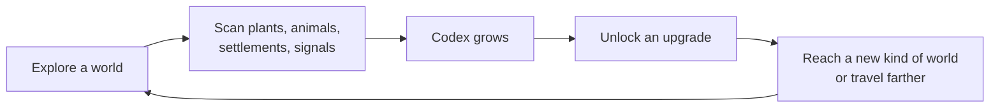

# Progression: documenting life to upgrade the ship

Status: **plan**. Nothing in this file is built yet unless it is ticked. Tick items off as they land.

Today you can fly anywhere, land, and catalogue plants, animals and settlements, but nothing comes of it. This plan gives exploring a purpose. **What you document becomes the knowledge your ship is built from.** Each upgrade lets you reach a new kind of place (underwater, lava shores, gas giant clouds, farther stars), and those places hold what the next upgrade needs.

There is no combat, mining or inventory. The only resource is knowledge.

## The core loop



An upgrade should open a door, not just make a number bigger. "+10% scan range" is fine as filler, but most nodes should let you go somewhere you couldn't go before.

## The key rule: requirements match traits, not named species

Every species is generated, so a requirement can never say "scan the Glowing Reef Eel". Requirements are **queries on traits the generator already produces**, such as:

- "Observe 3 animals from worlds with liquid seas"
- "Catalogue a glowing plant"
- "Observe a carnivore and the herbivore it hunts"
- "Record a village"

This has two benefits:

1. **Hints come for free.** A requirement for "a drifter" can say *Found on: thick-air or low-gravity worlds with complex life*, because that is what `PLANS.floater.fit` favours. The hint text is generated from the requirement, not written by hand.
2. **New generator traits automatically become new requirements.** Anything added to `flora.mjs` or `fauna.mjs` can be used in the tree.

### Traits available today

These all exist in the code now and can be used in requirements immediately.

| Source | Field | Values |
|---|---|---|
| World (`biomes.mjs` `classify`) | biome | Volcanic, Toxic, Desert, Verdant, Oceanic, Frozen, Amethyst, Barren |
| World (`body.physics`) | life | none, microbial, simple, complex |
| World | biochemistry | water, ammonia, methane, sulfur, silicon |
| World | waterState, subsurfaceOcean, tidallyLocked | liquid / ice / …, true/false |
| World | gravity, pressure, temperature, volcanism | numbers |
| Giant (`GIANT_CLOUDS`) | cloud type, rings | ammonia, methane, water, clear, alkali, silicate; ringed or not |
| Star (`physics.mjs`) | spectral class | O … M (half are red dwarfs) |
| Plant (`flora.mjs` `FORMS`) | form | tree, conifer, palm, shrub, grass, succulent, fungus, stalk, mat, mound; exotic: crystal, glasstree, chimney, plume, bulb, sheet, filament, crust |
| Plant | glow, habitat | 0–1; temperature / moisture / shore / highland preference |
| Animal (`fauna.mjs` `PLANS`) | body plan | quadruped, hexapod, biped, serpent, flyer, floater, arachnid, slug, radial, roller |
| Animal | form | runner, tank, raptor, mantis, spider, eel, bat, bell, manta, tripod, wheel, … |
| Animal | diet | herbivore, omnivore, carnivore, filter |
| Animal (`ecology.mjs`) | activity | diurnal, nocturnal, crepuscular, any |
| Animal | mind / civilization | instinctive … clever; tool users, village builders, city builders, planet-shapers, spacefarers |
| Settlement (`traces`) | level | the civilization level you recorded |
| Radio signal (`signals.mjs`) | source level | planet-shapers, spacefarers |

### Things to scan

| Category | Today | Later |
|---|---|---|
| **Flora** | ✅ catalogued by walking close (`catalogue`) | partial scans, rare variants |
| **Fauna** | ✅ observed from a distance (`bestiary`) | behaviour observations (hunting, sleeping, drinking) |
| **Settlements** | ✅ recorded within ~45 m (`traces`) | scanning individual building cultures |
| **Signals / field notes** | ✅ investigated on foot (`records`) | — |
| **Worlds from orbit** | partly (long-range biosignature scan on the map) | an orbital survey that records a world's biome, chemistry and life |
| **Geology** | ❌ not in the game | minerals and crystal formations per biome (would be the main "non-living" scan) |
| **Giant atmospheres** | ❌ | cloud samples with an atmospheric probe |

## The upgrade tree

Four branches. Each node lists what it does, what it needs, and whether the ability exists in the game yet. **"Needs building"** means the upgrade's effect is itself a to-do item (see the roadmap below). Counts are a first guess and should be tuned with `inspect.mjs --stats`.

The ship is the **Kestrel**. Requirements are cumulative across every system you have visited.

### Environment: which worlds you can set down on

| Node | Effect | Requires | Effect exists? |
|---|---|---|---|
| **Heat plating** | Land next to lava; star exclusion zone shrinks | 2 plants from Volcanic or Desert worlds · 1 succulent (pillar) | Partly: star heat exists, lava landing is blocked today |
| **Pressure hull I** | Dive into liquid seas (shallows) | 3 animals from worlds with liquid water · 1 coil or creeper (serpent / slug) · 1 shoreline plant | Needs building |
| **Pressure hull II** | Deep dives; reach subsurface oceans under ice | Pressure hull I · 1 drifter (floater) · 2 plants from Frozen worlds | Needs building |
| **Cryo seals** | Dive into methane and ammonia seas | Pressure hull I · 1 species from a methane world · 1 from an ammonia world | Needs building |
| **Gravity stabilizers** | Land on high-gravity worlds (above ~1.5 g, to tune) | 2 animals from worlds above 1.3 g · 1 shellback (tank form) | Needs a gate: today every world can be landed on |
| **Acid shielding** | Land on Toxic worlds | Heat plating · 1 species with sulfur biochemistry · 2 Volcanic-world plants | Needs a gate |
| **Cloud diver** | Descend below 250 m into gas giants | Pressure hull II · scan 3 giants with different cloud types · 2 drifters | Needs building |

### Propulsion: how far you can go

| Node | Effect | Requires | Effect exists? |
|---|---|---|---|
| **Jump drive II** | Jump range 12 → 16 ly | 5 plant species from 3 different biomes | Easy: `JUMP_RANGE` in `galaxy.mjs` becomes a function of upgrades |
| **Jump drive III** | Jump range → 24 ly | Jump drive II · 10 animals across 4 body plans | Easy |
| **Return beacons** | Fast-travel to any system you have **fully documented** | Fully document every plant and animal on 1 world | Needs building |
| **Signal drive** | Jump straight to any radio source you can hear (up to 150 ly) | Jump drive III · record a city-builder settlement | Needs building (signals already exist) |

Return beacons reward finishing a system instead of skimming it, and keep backtracking from becoming a chore.

### Scanner: how you find things

| Node | Effect | Requires | Effect exists? |
|---|---|---|---|
| **Orbital survey** | See a world's biome, chemistry and life level before landing; filter the map by a requirement you are tracking | 3 plants from 2 worlds | Partly: the map's long-range scan shows life at jump-range stars |
| **Life sonar** | HUD arrow to the nearest uncatalogued species | 5 animals including 1 nocturnal | Needs building |
| **Night filter** | See clearly at night; glowing species are highlighted | 2 glowing species (plant `glow` > 0.45 or animal glow markings) | Needs building |
| **Behaviour logger** | Unlocks behaviour observations: watch a hunt, a herd drinking, an animal sleeping | 1 carnivore and 1 herbivore it hunts (`ecology.mjs` food web) | Needs building (the behaviours exist) |
| **Xenolinguistics** | Settlements give longer field notes and point to the builders' other homes | Record tool users and village builders | Needs building |

### Tools: new ways to explore a world

| Node | Effect | Requires | Effect exists? |
|---|---|---|---|
| **Rover** | Fast surface travel without taking off | 4 animals with legs from 2 biomes | Needs building |
| **Survey drone** | Scan from a distance: cliffs, herds of skittish animals, high nests | 2 fliers (flyer plan) | Needs building |
| **Atmospheric probe** | Scan giant cloud layers from orbit | 1 drifter · visit 1 giant | Needs building |

### Ship classes: the big milestones

Upgrades are modules on a hull. A **new ship class** is a chapter break: more module slots, a new model in `kestrel.js`, and a bigger documentation milestone.

| Class | Requires | Opens |
|---|---|---|
| **Kestrel** (start) | — | today's game |
| **Petrel** (sea and storm ship) | 6 upgrades · fully documented 3 worlds in 3 biomes | Pressure hull II, Cloud diver, Signal drive |
| **Albatross** (deep-range ship) | 12 upgrades · recorded a planet-shaper or spacefarer world · species from 3 biochemistries | the last tier: long jumps toward the core, contact with spacefarers |

## Showing a node to the player

```
PRESSURE HULL I                                  ENVIRONMENT
Dive into liquid seas, down to the shallows.

  ☐ 3 animals from worlds with liquid water      2 / 3
      Found on: Oceanic and Verdant worlds
  ☑ 1 coil or creeper                            1 / 1
  ☐ 1 shoreline plant                            0 / 1
      Found on: coasts of worlds with seas
```

- On phones, use one list per branch (tabs), the same bottom-sheet pattern as the star map panel. Avoid a big pannable graph.
- **Track** a node to pin it on the HUD and highlight matching worlds on the map once Orbital survey is unlocked.
- When a scan counts toward something, the existing toast should say so: "New animal observed … counts toward Pressure hull I (2 / 3)".

## Data model (proposal)

A new module, `upgrades.mjs`, plain data with no Three.js, so it can be tested with `node --test` like the generators.

```js
export const UPGRADES = {
  pressureHull1: {
    branch: 'environment',
    name: 'Pressure hull I',
    effect: 'Dive into liquid seas, down to the shallows.',
    after: [],                         // prerequisite upgrades
    needs: [
      { kind: 'fauna', count: 3, world: { waterState: 'liquid' } },
      { kind: 'fauna', count: 1, species: { plan: ['serpent', 'slug'] } },
      { kind: 'flora', count: 1, species: { habitat: { shore: true } } },
    ],
  },
  // …
};

// progress(codex) -> { [upgradeId]: { met: [2, 1, 0], done: false } }
// hint(need)      -> "Found on: Oceanic and Verdant worlds"  (generated from the query)
```

The **codex** is a new save that holds one entry per scanned thing, with the traits copied in at scan time: `{ kind, seed, bodyId, speciesId, traits: { plan, diet, … }, world: { biome, gravity, … } }`. Copying the traits means requirements can be checked without regenerating old systems.

## Reachability

A player must never get stuck because nothing nearby matches the next requirement. The galaxy is fixed (`GALAXY_SEED`), so check it instead of patching it:

- A test walks outward from the starting star and asserts that every tier-1 requirement is met within a few jumps, and every requirement somewhere within the range the earlier tiers unlock.
- `inspect.mjs --stats` reports how common each requirement's match is, so counts can be tuned (for example, if drifters are 1 world in 40, don't ask for 3 early).
- If a requirement is too rare, change the requirement, not the galaxy.

## Roadmap / to-do

### Phase 0: already in the game
- [x] Catalogue plants by walking close
- [x] Observe animals from a distance
- [x] Record settlements and their civilization level
- [x] Investigate surface signals (field notes)
- [x] Long-range biosignature scan on the star map
- [x] Radio signals from planet-shapers and spacefarers

### Phase 1: the system itself (no new abilities yet)
- [ ] Global **codex** save across systems, with traits copied in at scan time (today saves are per system: `elsewhere-system-<seed>`)
- [ ] Backfill the codex from existing per-system saves
- [ ] `upgrades.mjs`: the tree as data, `progress()`, and generated "Found on" hints
- [ ] `upgrades.test.mjs`: matching, prerequisites, hints
- [ ] Reachability test and requirement frequencies in `inspect.mjs --stats`
- [ ] Upgrade screen (desktop + phone layout); open with a key and a HUD button
- [ ] Toasts say which upgrade a new scan counts toward
- [ ] Track a node and pin it on the HUD
- [ ] Save unlocked upgrades

### Phase 2: upgrades that only change numbers or gates
- [ ] Jump drive II / III (`JUMP_RANGE` reads unlocked upgrades)
- [ ] Heat plating: smaller star exclusion zone; allow landing beside lava
- [ ] Decide which worlds start locked (Toxic, high gravity) and add the gates
- [ ] Gravity stabilizers and Acid shielding lift those gates
- [ ] Orbital survey: world tags before landing; map filter for tracked requirements

### Phase 3: new abilities
- [ ] **Underwater**: ship below the sea surface, underwater fog and light, sea floor collision, depth limit per hull level (Pressure hull I / II)
- [ ] Aquatic life to find down there (new plant forms and swimming animals in `flora.mjs` / `fauna.mjs`)
- [ ] Subsurface oceans under ice (Pressure hull II)
- [ ] Methane and ammonia seas (Cryo seals)
- [ ] Gas giant descent below 250 m (Cloud diver)
- [ ] Return beacons (fast travel to fully documented systems)
- [ ] Signal drive (jump to a radio source)
- [ ] Life sonar, Night filter
- [ ] Rover, Survey drone, Atmospheric probe

### Phase 4: deeper scanning
- [ ] Behaviour observations (hunt, graze, drink, sleep), using what `ecology.mjs` already does
- [ ] Partial scans: several individuals to finish an entry
- [ ] Rare variants (albino, giant) worth bonus progress
- [ ] Geology scans: minerals and crystal formations per biome
- [ ] Name species you were first to document

### Phase 5: ship classes
- [ ] Module slots per hull
- [ ] Petrel and Albatross models and handling in `kestrel.js`
- [ ] Class milestones in the upgrade screen

## Open questions

- **Start locked or open?** Today every rocky world can be landed on. Locking Toxic and high-gravity worlds at the start gives early goals, but takes away freedom players have now. Alternative: keep everything open and gate only *new* places (underwater, giants, farther jumps).
- **Do counts scale?** Fixed small counts (1–5) keep it from feeling like a grind. Variety ("3 different body plans") should be the challenge, not volume.
- **Where does the codex live?** Probably `localStorage` next to `elsewhere-galaxy-v1`; it should survive generating a new test seed.
- **Ship names:** Kestrel → Petrel → Albatross are placeholders.
